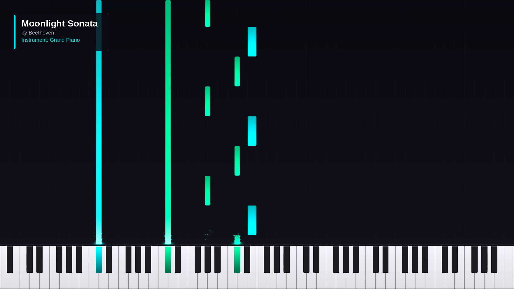

# Freerun ⚡

> **Ultra-fast GPU-accelerated Piano Visualizer (MP3 + MIDI → MP4)**

Freerun renders stunning Synthesia/Rousseau-style falling-note piano videos from any MP3 and MIDI pair at blistering speeds (**120+ FPS at 1080p60** and **270+ FPS at 720p60**, up to **4.5x faster than real-time**).

The name **Freerun** is a play on *freefall* (the notes cascading down from the top of the screen) fused with the concept of a *run* in music (a rapid, fluid succession of notes).



---

## ✨ Features

- 🚀 **Extreme Rendering Speed**:
  - **ModernGL GPU Instancing**: Batches thousands of notes, keys, flares, and particles into single GPU draw calls.
  - **Hardware Video Acceleration**: Auto-detects and uses GPU encoders (`h264_vaapi` on AMD/Intel, `h264_nvenc` on NVIDIA, `h264_qsv` on Intel) with zero-copy double-buffered streaming into FFmpeg.
  - **CPU Fallback**: Highly optimized multithreaded `libx264` preset for headless machines without hardware encoders.
- 🎹 **Realistic Piano Geometry**:
  - Full 88-key piano keyboard (A0 to C8) with exact acoustic key proportions.
  - Ivory white keys with bottom chamfers and side borders.
  - Obsidian black keys with top specular highlights and drop shadows.
  - Active keys light up with illumination gradients fading downwards.
- 🌟 **Visual Polish**:
  - SDF-antialiased capsule notes with vertical lighting gradients and strike flares.
  - Emissive bloom flares above active hit points.
  - Real-time rising spark ember particles when notes strike keys.
  - Lane guideline stripes and background dark vignette.
- 🎨 **Color Themes**:
  - `neon` (default: electric cyan, hot magenta, neon violet, amber, mint)
  - `synthwave` (retro 80s pink, purple, cyan, orange, yellow)
  - `rainbow` (smooth HSV spectral gradient from bass to treble)
  - `sunset` (crimson, fiery orange, golden amber, deep violet)
  - `ocean` (electric sky blue, royal blue, turquoise)
  - `emerald` (emerald green, teal, mint)
  - `fire` (red hot flame and blazing yellow)
  - `tracks` (independent color per MIDI track / hand)
  - Custom hex colors (`--color-left`, `--color-right`)
- 🏷️ **On-Screen Title & Instrument Badge**:
  - Displays music name (`--title`), instrument(s) used (`--instruments`), and artist (`--artist`) in a broadcast-style frosted glass badge with smooth fade animations.
  - Automatic metadata detection from MP3 ID3 tags and MIDI track names.
- ⏱️ **Audio Synchronization**:
  - Automatic lead-in delay (`--lead-in`) so the first notes fall smoothly into view before hitting keys.
  - Single-pass video encoding and audio muxing (no intermediate raw video files on disk).
  - Fine audio offset tuning (`--audio-offset`).
- 🔍 **Auto-Zoom Keyboard**:
  - `--auto-keys` dynamically frames only the active notes played in the song, making keys and notes larger.

---

## 🚀 Installation & Requirements

Ensure `ffmpeg` is installed on your system:
```bash
sudo apt install ffmpeg
```

Using `uv` (recommended):
```bash
# Clone or navigate to the directory
cd Decrescendo

# Run directly with uv
uv run freerun <song.mp3> <song.mid> -o <output.mp4>
```

---

## 📖 Usage Examples

### 1. Basic Render (Default 1080p 60 FPS)
```bash
uv run freerun song.mp3 song.mid -o visualizer.mp4
```

### 2. Maximum Speed Render (720p 60 FPS)
```bash
uv run freerun song.mp3 song.mid -o visualizer.mp4 --720p
```

### 3. Synthwave Style with Auto-Zoomed Keyboard
```bash
uv run freerun song.mp3 song.mid -o visualizer.mp4 --auto-keys -c synthwave
```

### 4. Rainbow Pitch Spectrum & Custom Lead-in
```bash
uv run freerun song.mp3 song.mid -o visualizer.mp4 -c rainbow --lead-in 3.0 --fall-time 2.5
```

### 5. Custom Track Colors (Left Hand vs Right Hand)
```bash
uv run freerun song.mp3 song.mid -o visualizer.mp4 --color-left "#00f2fe" --color-right "#ff0844"
```

### 6. Display Song Title, Instruments, and Artist
```bash
uv run freerun song.mp3 song.mid -t "Moonlight Sonata" -i "Grand Piano" --artist "Beethoven"
```

### 7. Force Specific Video Encoder
```bash
# Force VAAPI hardware encoding
uv run freerun song.mp3 song.mid --encoder vaapi

# Force CPU libx264 encoding
uv run freerun song.mp3 song.mid --encoder libx264
```

---

## ⚙️ CLI Reference

```
usage: freerun [-h] [-a AUDIO_OPT] [-m MIDI_OPT] [-o OUTPUT_OPT]
               [-t TITLE] [-i INSTRUMENTS] [--artist ARTIST]
               [--title-duration TITLE_DURATION] [--persistent-title] [--no-title]
               [-w WIDTH] [-H HEIGHT] [-r FPS] [--720p] [--1080p] [--4k]
               [--lead-in LEAD_IN] [--fall-time FALL_TIME]
               [--audio-offset AUDIO_OFFSET] [--duration DURATION]
               [-c {neon,synthwave,rainbow,sunset,ocean,emerald,fire,tracks}]
               [--color-left COLOR_LEFT] [--color-right COLOR_RIGHT]
               [--keyboard-height KEYBOARD_HEIGHT] [--auto-keys]
               [--min-key MIN_KEY] [--max-key MAX_KEY] [--no-particles]
               [--no-glow] [--encoder {auto,vaapi,nvenc,qsv,libx264}]
               [--crf CRF] [--preset PRESET]
               [audio_pos] [midi_pos] [output_pos]
```

| Option | Default | Description |
|---|---|---|
| `audio` | Positional / `-a` | Path to audio file (`.mp3`, `.wav`, etc.) |
| `midi` | Positional / `-m` | Path to MIDI file (`.mid`, `.midi`) |
| `output` | Positional / `-o` | Output video filename (`.mp4`) |
| `-t, --title` | Auto-detect | Music title displayed on the on-screen badge |
| `-i, --instruments` | Auto-detect | Instrument(s) used (e.g. `Grand Piano`, `Synth, Strings`) |
| `--artist` | Auto-detect | Artist or composer name |
| `--title-duration` | `7.0` | Seconds to display title badge (set `0` for persistent) |
| `--persistent-title`| `False` | Keep title badge visible throughout entire video |
| `--no-title` | `False` | Disable title badge overlay completely |
| `-w, --width` | `1920` | Video width |
| `-H, --height` | `1080` | Video height |
| `-r, --fps` | `60` | Frame rate |
| `--720p` / `--1080p` / `--4k` | | Quick resolution presets |
| `--lead-in` | `2.5` | Lead-in time (seconds) before first notes strike keys |
| `--fall-time` | `2.5` | Duration for notes to fall from screen top to keys |
| `--audio-offset` | `0.0` | Fine audio offset (+ delay, - advance) |
| `-c, --color-scheme` | `neon` | Palette (`neon`, `synthwave`, `rainbow`, `sunset`, `ocean`, `emerald`, `fire`, `tracks`) |
| `--color-left` | `None` | Custom hex color for track 0 / left hand |
| `--color-right` | `None` | Custom hex color for track 1 / right hand |
| `--auto-keys` | `False` | Auto-zoom keyboard to range of played notes |
| `--no-particles` | `False` | Disable spark ember particles |
| `--no-glow` | `False` | Disable bloom flares |
| `--encoder` | `auto` | Video encoder (`auto`, `vaapi`, `nvenc`, `qsv`, `libx264`) |
| `--crf` | `18` | Quality CRF level (lower is higher quality) |

---

## ⚡ Performance Architecture

1. **ModernGL GPU Instancing**: Every frame renders in **~6 total GPU draw calls** regardless of note density.
2. **Vectorized Note Slicing**: Binary search (`bisect`) and NumPy array masks retrieve visible notes in **< 10 µs** per frame.
3. **Double-Buffered Asynchronous Pipe**: GPU rendering and FFmpeg process I/O run on separate threads, preventing pipeline bottlenecks.
4. **Hardware Acceleration**: Automatic VAAPI/NVENC/QSV detection allows encoding at up to **270+ FPS**.

---

## 💡 Credits

Engineered and built with **Gemini 3.8 Flash**.
